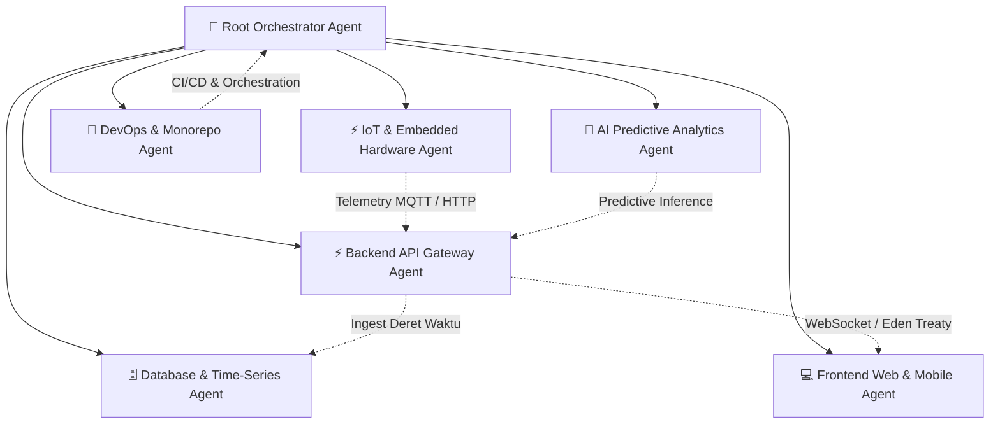

# 🤖 UrbanGrow Multi-Agent System: Master Orchestration Guide (AGENTS.md)

> **Proyek**: *UrbanGrow Smart Aquaponic Berbasis IoT & Predictive AI untuk Sistem Pangan Perkotaan Adaptif terhadap Perubahan Iklim*  
> **Institusi**: SMK Telkom Sidoarjo (Regu Mawar: Reyjuno Al Cannavaro, Gabriella Fajar Setiwan, Marcellina Septya Safira)  
> **Status Monorepo**: Active Multi-Agent Workspace (Moonrepo v2 + Bun + Next.js 16 + ElysiaJS + Flutter + FastAPI + TimescaleDB)

---

## 🧭 1. Arsitektur Multi-Agent & Domain Boundaries

Monorepo UrbanGrow dikelola oleh jaringan agen AI otonom terspesialisasi yang saling melengkapi sesuai prinsip **Separation of Concerns (SoC)** dan **Evidence-Based Climate Adaptive Design (ECAD)**:

---

## 👥 2. Matriks Tanggung Jawab Bidang (Domain Responsibility Matrix)

| Bidang / Agen | Cakupan Direktori | Teknologi Utama | Mandat & Peran Utama |
|---|---|---|---|
| **IoT & Embedded** | `apps/iot-simulator`, `.agents/rules/iot-embedded-agent.md` | ESP32, C++/Arduino, FreeRTOS | Akuisisi 6 sensor (pH, TDS, DS18B20, DHT22, BH1750, Water Level), kendali 4 relay aktuator, fail-safe watchdogs. |
| **Backend Gateway** | `services/backend`, `services/backend/AGENTS.md` | ElysiaJS, Bun, TypeScript, Eden Treaty | High-throughput REST API, WebSocket/SSE telemetri streaming, autentikasi, actuator safety override dispatch. |
| **Database & Time-Series** | `services/backend/src/db`, `.agents/rules/database-agent.md` | PostgreSQL 16, TimescaleDB, Drizzle ORM | Hypertables telemetri, continuous aggregates (1m/1h/1d), retensi data 90 hari, query deret waktu teroptimasi. |
| **Frontend Web** | `apps/web`, `apps/web/AGENTS.md` | Next.js 16, React 19, Tailwind CSS v4, Lucide | Dark-tech analytics dashboard, visualisasi 4-level vertical aquaponic, chart interaktif, real-time indicator cards. |
| **Frontend Mobile** | `apps/mobile`, `apps/mobile/AGENTS.md` | Flutter 3.x, Dart, Riverpod, Material 3 | Mobile control center, push notifications, offline telemetry caching, modal kendali aktuator darurat. |
| **AI & Data Intelligence** | `services/ai-engine`, `services/ai-engine/AGENTS.md` | Python 3.11, FastAPI, XGBoost, Scikit-Learn | Deteksi anomali multi-variat (Isolation Forest), estimasi waktu panen (GDD), Climate Adaptation Score. |
| **DevOps & Monorepo** | `.moon`, `.agents/rules/devops-agent.md` | Moonrepo v2, Docker Compose, GitHub Actions | Orkestrasi build monorepo, task caching, containerization multi-stack, edge deployment (Raspberry Pi/Mini PC). |

---

## 📜 3. Aturan Operasional Global untuk Semua AI Agent

1. **Prinsip Evidence-Based Climate Adaptive Design (ECAD)**:
   - Setiap fitur dan perubahan parameter biologis/teknis harus merujuk pada standar adaptasi iklim:
     - pH air ideal: `6.5 - 7.5`
     - TDS nutrisi ideal: `400 - 800 ppm` (fase vegetatif kangkung & pakcoy)
     - Suhu air ideal: `22 - 27°C` (Ikan Nila & Lele)
     - Target DO air: `>5-6 mg/L` untuk Nila (Level 3), Lele toleran `<3 mg/L` (Level 1)
2. **Kesesuaian Monorepo Moonrepo**:
   - Dilarang menjalankan skrip ad-hoc di luar target Moonrepo. Selalu gunakan `moon run <project>:<task>`.
3. **Komitmen Anti-Regresi**:
   - Agen dilarang memotong (truncate) kode eksisting atau mengganti implementasi nyata dengan placeholder/TODO.
4. **Keamanan Aktuator & Hardware**:
   - Perintah aktuator wajib memiliki batas waktu maksimal (*software timeout*) dan status interlock perangkat keras.

---

## 🔄 4. Protokol Komunikasi Antar-Agen (A2A Communication)

Setiap agen beroperasi secara otonom namun terkoordinasi melalui topologi event-driven:

1. **Topik MQTT Terstandarisasi**:
   - `urbangrow/{device_id}/telemetry` -> Telemetri 5 detik dari ESP32 menuju Backend.
   - `urbangrow/{device_id}/actuator/{name}/set` -> Perintah ubah relay dari Backend ke ESP32.
   - `urbangrow/{device_id}/alerts` -> Siaran anomali threshold kritis ke Web & Mobile.
   - `urbangrow/{device_id}/ai/inference` -> Permintaan inferensi dari Backend ke AI Engine.
2. **Zero-Drift Contract Synchronization**:
   - Backend ElysiaJS mengekspor tipe skema via Eden Treaty (`export type App = typeof app`).
   - Frontend Web (`apps/web`) mengimpor tipe kontrak langsung dari paket backend tanpa duplikasi manual definisi TypeScript.
   - AI Engine (`services/ai-engine`) mereferensikan skema data yang kompatibel dengan JSON schema telemetri.

---

## 📚 5. Direktori Dokumen Agen Spesialis

- ⚡ **IoT & Hardware Agent**: [iot-embedded-agent.md](file:///c:/Users/Rey%20Cannavaro/urbangrow-workspace/.agents/rules/iot-embedded-agent.md)
- 🧪 **IoT Simulator Agent**: [apps/iot-simulator/AGENTS.md](file:///c:/Users/Rey%20Cannavaro/urbangrow-workspace/apps/iot-simulator/AGENTS.md)
- 💻 **Web Frontend Agent**: [apps/web/AGENTS.md](file:///c:/Users/Rey%20Cannavaro/urbangrow-workspace/apps/web/AGENTS.md)
- 📱 **Mobile Frontend Agent**: [apps/mobile/AGENTS.md](file:///c:/Users/Rey%20Cannavaro/urbangrow-workspace/apps/mobile/AGENTS.md)
- ⚡ **Backend Gateway Agent**: [services/backend/AGENTS.md](file:///c:/Users/Rey%20Cannavaro/urbangrow-workspace/services/backend/AGENTS.md)
- 🗄️ **Database & TimescaleDB Agent**: [database-agent.md](file:///c:/Users/Rey%20Cannavaro/urbangrow-workspace/.agents/rules/database-agent.md)
- 🧠 **AI & Predictive Engine Agent**: [services/ai-engine/AGENTS.md](file:///c:/Users/Rey%20Cannavaro/urbangrow-workspace/services/ai-engine/AGENTS.md)
- 🚀 **DevOps & Monorepo Agent**: [devops-agent.md](file:///c:/Users/Rey%20Cannavaro/urbangrow-workspace/.agents/rules/devops-agent.md)
