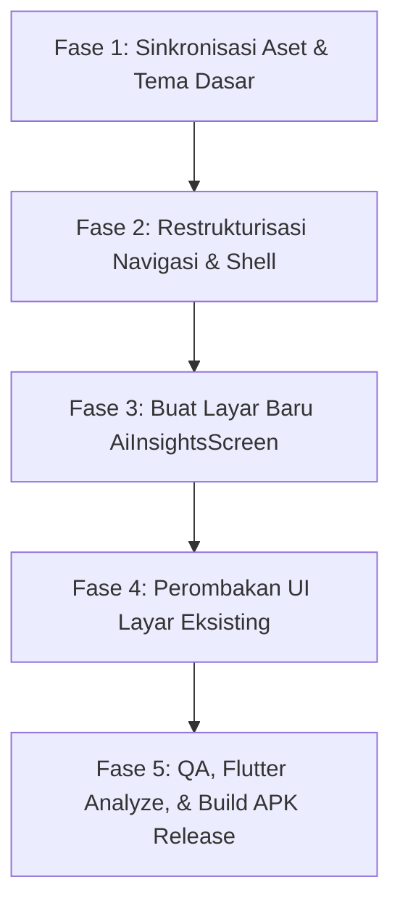

# 📱 UrbanGrow Mobile App (Flutter) Overhaul Specification & Roadmap (MOBILE-DEV.md)

> **Dokumen**: Master Blueprint & Roadmap Perombakan Aplikasi Mobile Flutter  
> **Proyek**: *UrbanGrow Smart Aquaponic Berbasis IoT & Predictive AI untuk Sistem Pangan Perkotaan Adaptif terhadap Perubahan Iklim*  
> **Target Aplikasi**: `apps/mobile` (Flutter 3.44.x, Dart 3.12.x, Riverpod 3.x, Android Release APK)  
> **Standar Rujukan Desain**: [docs/DESIGN.md](file:///c:/Users/Rey%20Cannavaro/urbangrow-workspace/docs/DESIGN.md) (*Pine Executive & Scandinavian Botanical Agro-Tech*)  
> **Status**: Ready for Implementation (Siap Dieksekusi Bertahap)  
> **Lokasi File**: `MOBILE-DEV.md`

---

## 🧭 1. Ringkasan Eksekutif & Tujuan Perombakan

Aplikasi mobile UrbanGrow (`apps/mobile`) merupakan **Control Center & Field Companion** portabel bagi operator dan juri pameran untuk memantau menara akuaponik 4-level secara real-time langsung dari perangkat genggam (smartphone Android).

### 🎯 Misi Perombakan:
1. **100% Zero-Drift Visual Alignment**: Menyelaraskan seluruh palet warna, tipografi, radius sudut (*signature 24px radius*), dan gaya kartu agar identik dengan Web Dashboard (`apps/web`).
2. **Koreksi Aset Branding & Logo**: Mengganti teks/bulatan placeholder pada header dengan **Logo Resmi UrbanGrow** (`urbangrow-logo.png`).
3. **Penyelarasan Menu & Navigasi**: Memperluas navigasi dari 5 tab lama menjadi **6 Menu Utama Lengkap** yang selaras dengan Web Dashboard (termasuk modul baru **Prediksi AI** yang sebelumnya belum ada di mobile).
4. **Pembersihan Scope Aktuator**: Menghapus seluruh residu aktuator *Pompa Dosing Buffer (RELAY-05)* sehingga murni hanya menampilkan **4 Aktuator Resmi** (`waterPump`, `aerator`, `growLight`, `feeder`).
5. **Anti-Slop & Professional Polish**: Menghapus emoji kartun anak-anak di header kartu, menghilangkan efek shadow material default yang berat, dan menerapkan angka tabular (`.num-tabular`) agar antarmuka tampil tenang, presisi, dan bertaraf industri.

---

## 🔍 2. Audit Komparasi: Kondisi Saat Ini vs. Target Standar Web

| Aspek / Fitur | Kondisi Saat Ini di `apps/mobile` | Target Standar Web (`apps/web` & `docs/DESIGN.md`) | Status Aksi |
|---|---|---|---|
| **Logo Header** | Titik hijau kecil + teks biasa `"UrbanGrow"`. | Logo resmi [urbangrow-logo.png](file:///c:/Users/Rey%20Cannavaro/urbangrow-workspace/apps/web/public/urbangrow-logo.png) (daun hijau botani + teks tegas). | 🔴 **Wajib Ganti** |
| **Navigasi Tab Bawah** | 5 Tab: *Beranda, Menara, Kontrol, Metrik, AgriBot*. | 6 Menu: *Dashboard, Menara Kaskade, Kontrol Relay, Analitik IoT, Prediksi AI, AgriBot*. | 🔴 **Restrukturisasi** |
| **Fitur Prediksi AI** | **Belum ada** (*Missing Feature* di mobile). | Layar khusus: Model GDD Panen Pakcoy/Kangkung, Model ADG Ikan, Climate Adaptation Score. | 🔴 **Buat Layar Baru** |
| **Daftar Aktuator** | Terkadang memuat Pompa Dosing (RELAY-05). | Murni **4 Relay Aktuator**: Pompa Sirkulasi (14), Aerator (26), Grow Light (33), Feeder (25). | 🟢 **Hapus Dosing** |
| **Warna & Palet** | Campuran warna lama (charcoal, yellow, cyan). | **Pine Botanical**: `--pine-primary: #165B39`, Mint Wash `#DCFCE7`, Slate `#111827`, Frame `#F0F2F5`. | 🟡 **Tuning Theme** |
| **Tipografi** | Default Material TextTheme / Plus Jakarta Sans. | **Geist Sans** (Antarmuka) & **Geist Mono** (Data Telemetri / Angka Tabular). | 🟡 **Standardisasi** |
| **Elevasi & Shadow** | Shadow blur tebal Material Design 3. | Flat elevation (`elevation: 0`) + Hairline 1px border (`#E5E7EB`) + radius sudut `24px`. | 🟡 **Polishing UI** |
| **Chatbot AgriBot** | Tampilan chat standar, rentan bocor raw markdown. | Gelembung hijau `#165B39`, kartu asisten putih bersih tanpa tanda pagar `###`, chip telemetri live. | 🟡 **Refactor UI** |

---

## 🎨 3. Standar Desain Visual Mobile (Pine Executive System)

Setiap komponen Flutter wajib merujuk pada konstanta tema sentral di `apps/mobile/lib/core/theme/app_theme.dart`:

```dart
class AppTheme {
  // Kanvas & Permukaan
  static const Color canvas       = Color(0xFFF0F2F5); // Viewport background cool gray
  static const Color surface      = Color(0xFFFFFFFF); // Card surface putih bersih
  static const Color surfaceSubtle= Color(0xFFF8F9FA); // Container input & tab pill

  // The Pine Botanical Accent (Warna Brand Utama)
  static const Color pinePrimary  = Color(0xFF165B39); // Deep Forest Pine
  static const Color pineHover    = Color(0xFF124B2E);
  static const Color sageMint     = Color(0xFF4EAB7C); // Aksen grafik & visualizer
  static const Color mintWash     = Color(0xFFDCFCE7); // Background badge optimal
  static const Color mintText     = Color(0xFF166534); // Teks badge optimal

  // Teks & Tinta
  static const Color textPrimary  = Color(0xFF111827); // Charcoal Ink (anti-#000000)
  static const Color textSecondary= Color(0xFF4B5563); // Deskripsi teknis
  static const Color textMuted    = Color(0xFF9CA3AF); // Satuan & metadata

  // Border & Hairlines
  static const Color borderLight  = Color(0xFFE5E7EB); // Hairline 1px solid
  static const Color borderMedium = Color(0xFFD1D5DB); // Hover / Selected border

  // Semantic Status
  static const Color statusOptimal= Color(0xFF166534); // Hijau optimal
  static const Color statusWarning= Color(0xFFB45309); // Kuning peringatan (Bg: #FEF3C7)
  static const Color statusAlert  = Color(0xFFE11D48); // Merah kritis (Bg: #FFE4E6)

  // Signature Radius & Hairline Decoration
  static final BorderRadius cardRadius = BorderRadius.circular(24.0);
  static final BorderRadius pillRadius = BorderRadius.circular(999.0);
  
  static BoxDecoration cardDecoration({Color? color, Border? border}) => BoxDecoration(
    color: color ?? surface,
    borderRadius: cardRadius,
    border: border ?? Border.all(color: borderLight, width: 1.0),
    boxShadow: const [
      BoxShadow(
        color: Color(0x05111827),
        blurRadius: 8,
        offset: Offset(0, 2),
      ),
    ],
  );
}
```

---

## 🏛️ 4. Arsitektur Navigasi & Struktur Layar (The 6-Screen Architecture)

Untuk mempertahankan keterbacaan yang nyaman di layar smartphone tanpa membuat bottom navigation bar terlalu sesak, arsitektur navigasi mobile dirancang dengan pola **Top Header Brand + 5 Bottom Tabs + 1 Quick Insight Action**:

```
+-------------------------------------------------------------------------+
| UNIVERSAL HEADER: [Official Logo Image]  •  [Live Pill: ESP32-GROW-01]  • [Bell: 2] |
+-------------------------------------------------------------------------+
|                                                                         |
| ACTIVE VIEW CONTENT AREA (IndexedStack / Nested Navigator):             |
|                                                                         |
|  1. DashboardScreen      --> Ringkasan WQI, 2x2 Bento Metrik, Status IoT |
|  2. EcosystemScreen      --> 4-Level Menara Vertikal Kaskade            |
|  3. ControlsScreen       --> 4 Relay Saklar Taktil & Quick Dispenser    |
|  4. AnalyticsScreen      --> Multi-Trace Fluktuasi Sensor 60-Sampel     |
|  5. AiInsightsScreen     --> Model GDD & ADG Panen, Climate Score (BARU)|
|  6. AgriBotScreen        --> Chat AI Agronomist Multimodal Gemini       |
|                                                                         |
+-------------------------------------------------------------------------+
| FLOATING PILL DOCK (Bottom Nav):                                        |
| [ 🏠 Dashboard ] [ 🏗️ Menara ] [ ⚡ Kontrol ] [ 📈 Analitik ] [ 🧠 AI ] |
| *(AgriBot dapat diakses via tab ke-5 atau floating action pill)*       |
+-------------------------------------------------------------------------+
```

---

## 📱 5. Blueprint Spesifikasi Detail Setiap Layar

### 5.1. Universal Top Header (`universal_header.dart`)
- **Branding**:
  - Tampilkan logo gambar asli: `Image.asset('assets/images/urbangrow-logo.png', height: 26, fit: BoxFit.contain)`.
  - Hapus lingkaran dot hijau buatan lama.
- **Node Status Pill**:
  - Kapsul monospaced: `ESP32-GROW-01` dengan pulsing green dot jika `isLive == true`.
- **Notifikasi Bell Icon**:
  - Tombol lingkaran putih `36px` ber-hairline border dengan badge merah kecil jika ada alert aktif (`alerts.length > 0`). Membuka `AlertsModalSheet`.

---

### 5.2. Layar 1: Dashboard (`dashboard_screen.dart`)
- **Inverted Hero Card (Kualitas Air WQI)**:
  - Tinggi: `150px`, Latar belakang hijau penuh `#165B39`, teks putih.
  - Angka display WQI: `85%` tabular font.
  - Tombol aksi lingkaran putih di kanan atas (`h-8 w-8`) dengan panah 45° yang mengarah ke tab Analitik.
- **2x2 Bento Grid Metrik Sensor**:
  - 4 Kartu putih (`Suhu Air Kolam`, `pH Air Kolam`, `Suhu Udara Luar`, `Cahaya Ambien LDR`).
  - Radius sudut `24px`, padding `16px`.
  - Menampilkan angka tabular dengan format unit yang tepat (`25.4 °C`, `7.15 pH`, `28.6 °C`, `560 lux`).
- **Studio Hardware Strip**:
  - Strip informasi perangkat keras: `ESP32-GROW-01 • 4/4 sensor fisik live • Relay Aktif via HTTPS`.
- **Quick Actuator Bar**:
  - Menampilkan status ringkas Pompa Sirkulasi (ON/OFF).

---

### 5.3. Layar 2: Menara Kaskade (`ecosystem_screen.dart`)
- **Visualisasi Arsitektur 4-Level Kaskade Vertikal**:
  - **Level 4 (Paling Atas)**: Talang Vertikal Pakcoy (Fase Vegetatif, Hidroton, TDS 580 ppm).
  - **Level 3**: Talang Vertikal Kangkung (Biofilter Sekunder, DO > 5.0 mg/L).
  - **Level 2**: Modul Biofilter Nitrifikasi (Bakteri *Nitrosomonas* & *Nitrobacter* mengubah amonia menjadi nitrat).
  - **Level 1 (Paling Bawah)**: Kolam Utama Ikan Nila & Ikan Lele (Suhu 24–27°C).
- **Diagram Aliran Tertutup Siklus Nitrogen (Closed-Loop Nitrogen Flow)**:
  - Ilustrasi diagram kartu yang menjelaskan konversi biologis alami tanpa pupuk kimia sintetis.

---

### 5.4. Layar 3: Kontrol Relay Aktuator (`controls_screen.dart`)
- **Power Consumption Meter Hero**:
  - Modul pemantau beban listrik: Total Watt saat ini (misal: `45 W`) dan estimasi konsumsi harian (`kWh`).
- **4 Kartu Relay Aktuator Presisi (Dilarang Memuat Pompa Dosing!)**:
  1. **Pompa Sirkulasi 12V (`waterPump`)**:
     - Kode: `RELAY-01` | Pin: `GPIO 14` | Status: `Terpasang Fisik (Active-LOW)`.
     - Beban: `45 Watt` | 12V DC.
  2. **Aerator Oksigen Nila (`aerator`)**:
     - Kode: `RELAY-02` | Pin: `GPIO 26` | Status: `Tahap Pengembangan`.
     - Beban: `18 Watt` | 12V DC.
  3. **Grow Light Fotosintesis (`growLight`)**:
     - Kode: `RELAY-03` | Pin: `GPIO 33` | Status: `Tahap Pengembangan`.
     - Beban: `85 Watt` | 12V DC.
  4. **Auto-Feeder Dispenser (`feeder`)**:
     - Kode: `RELAY-04` | Pin: `GPIO 25` | Status: `Tahap Pengembangan`.
     - Beban: `12 Watt` | 12V DC.
- **Saklar Taktil (Tactile Toggle Switch)**:
  - Trek saklar berukuran proporsional (`44 x 24`), knob putih bergeser halus dengan haptic feedback (`HapticFeedback.lightImpact()`).
  - Proteksi software interlock: Jika alat offline atau aktuator tahap pengembangan, saklar otomatis kembali OFF dalam 700ms disertai toast penjelasan.
- **Quick Feed Dispenser**:
  - Tombol dispenser pakan instan dengan countdown durasi 3 detik (*pulse trigger*).
- **Emergency Kill Switch**:
  - Tombol merah proteksi darurat untuk mematikan seluruh relay seketika saat terjadi anomali kritis.

---

### 5.5. Layar 4: Analitik IoT (`analytics_screen.dart`)
- **Pill Selector Kanal**:
  - Opsi filter cepat: `Semua Kanal`, `pH Air`, `Suhu Air`, `Suhu Udara`, `Cahaya LDR`.
- **Kurva Fluktuasi Telemetri (Sliding Window 60-Sampel)**:
  - Grafik garis multi-trace dengan kurva bezier halus (`strokeWidth: 2.2`).
  - Garis batas threshold aman biologis (garis putus-putus tipis).
- **Ringkasan Statistik 4 Sensor Fisik**:
  - Tabel grid min, max, rata-rata, dan status stabilitas parameter.

---

### 5.6. Layar 5: Prediksi AI & Adaptasi Iklim (`ai_insights_screen.dart`) — *FITUR BARU!*
- **Climate Adaptation Score (CAS) Card**:
  - Pengukur skor ketahanan iklim (0–100) berbasis fluktuasi cuaca ekstrem Sidoarjo.
- **Model GDD (Growing Degree Days) Panen Tanaman**:
  - **Pakcoy (Level 4)**: Progres vegetatif (%), akumulasi derajat hari, estimasi sisa hari menuju panen (Target: 30 hari).
  - **Kangkung (Level 3)**: Progres vegetatif (%), estimasi panen cepat (Target: 21 hari).
- **Model ADG (Average Daily Gain) Bobot Ikan**:
  - Pertumbuhan biomassa ikan Nila & Lele: Estimasi bobot rata-rata gram/ekor, rasio konversi pakan (FCR).
- **Banner Status Kalibrasi**:
  - Keterangan bahwa model terkalibrasi secara dinamis oleh 4 sensor fisik ESP32 live.

---

### 5.7. Layar 6: AgriBot AI Agronomist (`agribot_screen.dart`)
- **Header Chat**:
  - Indikator model AI (`gemini-2.5-flash`), latensi inferensi, dan tombol reset sesi.
- **Live Context Pill**:
  - Strip kecil di atas input teks: `Terhubung telemetri live ESP32-GROW-01 (4/4 sensor)`.
- **Gelembung Pesan Pengguna**:
  - Latar hijau botani `#165B39`, teks putih, sudut melengkung `18px`.
- **Gelembung Pesan AgriBot**:
  - Kartu putih bersih bergaris tipis `#E5E7EB`.
  - **Aturan Bebas Slop**: Dilarang merender tanda pagar markdown mentah (`###`, `####`). Format subjudul dirender menjadi teks bold rapi dengan spasi elegan.
- **Tombol Prompt Cepat (Quick Chips)**:
  - Kapsul pill horizontal: *"Evaluasi Kesiapan Proyek"*, *"Cek Parameter Air"*, *"Jadwal Panen Pakcoy"*.
- **Upload / Kamera Foto Diagnostik**:
  - Tombol icon kamera/gambar untuk mengirimkan foto daun menguning atau sisik ikan guna dianalisis oleh model multimodal Gemini.

---

## 🚀 6. Rencana Kerja Implementasi Bertahap (5-Phase Roadmap)



### 🔹 Fase 1: Sinkronisasi Aset & Tema Dasar (`apps/mobile`)
1. Salin file logo resolusi tinggi dari `apps/web/public/urbangrow-logo.png` ke `apps/mobile/assets/images/urbangrow-logo.png`.
2. Update `apps/mobile/lib/core/theme/app_theme.dart` agar 100% menggunakan warna, border radius `24px`, dan styling tabular font yang identik dengan `docs/DESIGN.md`.
3. Verifikasi konfigurasi aset pada `apps/mobile/pubspec.yaml`.

### 🔹 Fase 2: Restrukturisasi Navigasi & Shell (`main_shell_screen.dart`)
1. Ganti tampilan `UniversalHeader` agar merender logo gambar resmi, bukan lingkaran placeholder.
2. Atur navigasi 5/6 tab dengan label konsisten: `Dashboard`, `Menara`, `Kontrol`, `Analitik`, `Prediksi AI`, `AgriBot`.
3. Gunakan icon modern yang bersih dan konsisten (Material Rounded / Cupertino).

### 🔹 Fase 3: Pembuatan Modul Prediksi AI (`lib/features/ai_insights/`)
1. Buat folder baru `apps/mobile/lib/features/ai_insights/presentation/screens/ai_insights_screen.dart`.
2. Hubungkan ke data API backend `/api/ai/predictions` atau state telemetri untuk merender GDD pakcoy, GDD kangkung, bobot ikan, dan Climate Adaptation Score.

### 🔹 Fase 4: Perombakan UI Layar Eksisting
1. **Controls Screen**: Hapus seluruh referensi Pompa Dosing. Pastikan hanya ada 4 kartu relay (Water Pump, Aerator, Grow Light, Feeder).
2. **Dashboard Screen**: Rapikan layout kartu hero WQI (latar hijau `#165B39`, tombol lingkaran panah 45°).
3. **AgriBot Screen**: Bersihkan parser markdown agar tidak ada kebocoran tanda pagar `###`.
4. **Ecosystem Screen**: Pastikan sinkron dengan visualisasi menara 4-level.

### 🔹 Fase 5: QA, Pengujian, & Kompilasi APK Final
1. Jalankan `flutter analyze` di folder `apps/mobile` (harus `0 issues found`).
2. Uji coba fungsionalitas tombol saklar relay dan penerimaan telemetri live dari ESP32.
3. Jalankan kompilasi APK release final:
   ```powershell
   cd apps/mobile
   flutter build apk --release
   ```
4. Salin file APK output ke `apps/web/public/download/urbangrow.apk` agar tombol download di website aktif!

---

## ✅ 7. Kriteria Keberhasilan (Acceptance Criteria)

- [ ] Logo resmi UrbanGrow tampil jernih di header atas aplikasi mobile.
- [ ] Seluruh kartu di aplikasi mobile memiliki radius sudut `24px` dan border hairline `#E5E7EB`.
- [ ] Tidak ada kartu aktuator "Pompa Dosing" yang muncul di tab Kontrol maupun Dashboard.
- [ ] Tab "Prediksi AI" tersedia dan menampilkan estimasi panen GDD tanaman serta ADG ikan.
- [ ] Obrolan AgriBot tidak membocorkan format tanda pagar markdown `###`.
- [ ] Perintah relay pada Pompa Sirkulasi (GPIO 14) tersinkronisasi sukses ke ESP32 fisik.
- [ ] File APK berhasil di-compile tanpa error (`flutter build apk --release`) dan siap di-install di smartphone Android juri pameran.
