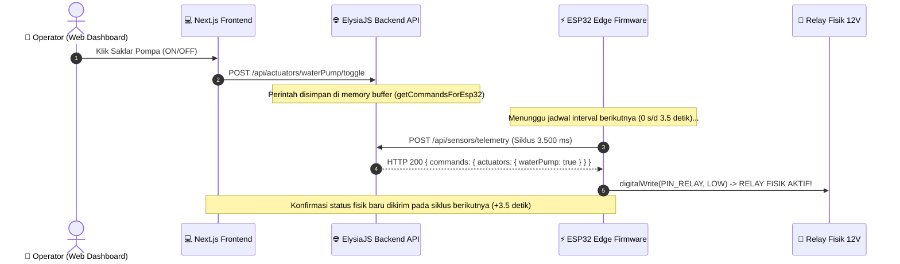

# ⚡ UrbanGrow Actuator Latency & Delay Optimization Runbook

> **Dokumen**: Panduan Implementasi Teknis & Strategi Reduksi Delay Kontrol Relay Aktuator  
> **Target**: ESP32 DevKit V1, ElysiaJS Backend API, Mosquitto MQTT, & Next.js 16 Web  
> **Status**: Ready for Future Development (Siap Diaktifkan Kapan Saja)  
> **Lokasi File**: `docs/ACTUATOR_LATENCY_OPTIMIZATION.md`

---

## 🧭 1. Latar Belakang & Analisis Akar Masalah (Root Cause)

Pada prototipe awal, perintah saklar ON/OFF aktuator (pompa, aerator, lampu, feeder) dari Web Dashboard mengalami jeda fisik (*observable latency*) sekitar **1.5 hingga 3.5 detik** sebelum relay berbunyi *klik*.

### 1.1. Diagram Alur Komunikasi Saat Ini (HTTP Polling Downlink)



### 1.2. Rumus Akumulasi Latensi
$$\text{Total Latensi} = T_{\text{wait\_interval}} + T_{\text{tls\_handshake}} + T_{\text{json\_parse}} + T_{\text{ui\_sync}}$$

- $T_{\text{wait\_interval}}$: **0 – 3.500 ms** (rata-rata 1.750 ms) karena ESP32 hanya mengecek perintah baru saat mengirim data telemetri.
- $T_{\text{tls\_handshake}}$: **300 – 600 ms** (overhead enkripsi HTTPS `WiFiClientSecure` di ESP32).
- $T_{\text{json\_parse}}$: **20 – 50 ms** (penguraian JSON respons oleh `ArduinoJson`).
- $T_{\text{ui\_sync}}$: **0 – 1.500 ms** (siklus polling status frontend di browser).

---

## 📊 2. Matriks Pilihan Solusi Optimasi

| Strategi | Estimasi Latensi | Kompleksitas Koding | Beban Jaringan/CPU | Waktu Eksekusi |
|---|---|---|---|---|
| **Opsi 1: Fast Telemetry Interval** | **0.5 – 1.2 detik** | ⭐ Sangat Rendah | Sedikit bertambah (60 req/min) | ~1 Menit |
| **Opsi 2: Dual-Loop Polling (Fast Command)** | **400 – 700 ms** | ⭐⭐ Sedang | Rendah (pemisahan payload) | ~15 Menit |
| **Opsi 3: Event-Driven MQTT (Standar Industri)** | **30 – 80 ms** *(Instan)* | ⭐⭐⭐ Menengah | Sangat Ringan (TCP socket persisten) | ~30 Menit |
| **Opsi 4: Frontend UI Tactile Feedback** | **0 ms** *(Persepsi visual)* | ⭐ Rendah | Tidak ada dampak hardware | ~10 Menit |

---

## 🛠️ 3. OPSI 1: Fast Telemetry Interval (Solusi Cepat 1 Menit)

Jika tim ingin mempersingkat delay tanpa mengubah arsitektur jaringan, cukup turunkan interval polling di firmware ESP32.

### Langkah Implementasi:
Buka file [esp32_urbangrow_og.ino](file:///c:/Users/Rey%20Cannavaro/urbangrow-workspace/firmware/esp32_urbangrow_og/esp32_urbangrow_og.ino) pada baris 20:

```cpp
// SEBELUMNYA (3.5 Detik):
const unsigned long SEND_INTERVAL_MS = 3500;

// UBAH MENJADI (1.2 Detik):
const unsigned long SEND_INTERVAL_MS = 1200;
```

> [!NOTE]
> Backend ElysiaJS di-compile menggunakan Bun runtime yang sanggup melayani puluhan ribu request per detik. 60–80 request per menit dari ESP32 sama sekali tidak membebani server. Database sudah diproteksi dengan mekanisme throttle penulisan snapshot per 12 detik.

---

## 🛠️ 4. OPSI 2: Dual-Loop Polling (High-Frequency Command)

Memisahkan loop pengiriman data telemetri (sensor) dengan loop pengecekan instruksi aktuator (command).

### Langkah Implementasi di ESP32:
Tambahkan interval terpisah di file firmware:

```cpp
// 1. Deklarasi Konstanta Waktu Terpisah
const unsigned long TELEMETRY_INTERVAL_MS = 3500; // Kirim sensor tetap tiap 3.5 detik
const unsigned long COMMAND_CHECK_MS      = 600;  // Cek perintah relay tiap 600 ms

unsigned long lastTelemetryTime = 0;
unsigned long lastCommandTime   = 0;

// 2. Fungsi Pengecekan Perintah Cepat (Payload Ringan)
void checkActuatorCommandsFast() {
  if (WiFi.status() != WL_CONNECTED) return;

  WiFiClientSecure client;
  client.setInsecure();
  HTTPClient https;
  https.setTimeout(1200);

  // Endpoint khusus yang hanya mengembalikan status saklar (50 byte JSON)
  if (https.begin(client, "https://urbangrow-api.reycannavaro.dev/api/iot/commands")) {
    int code = https.GET();
    if (code == 200) {
      JsonDocument doc;
      deserializeJson(doc, https.getString());
      if (doc["actuators"].is<JsonObject>()) {
        bool targetPump = doc["actuators"]["waterPump"];
        if (targetPump != isPumpOn) {
          setPump(targetPump);
        }
      }
    }
    https.end();
  }
}

// 3. Pada loop() Utama:
void loop() {
  unsigned long now = millis();

  // Task 1: Cek perintah aktuator setiap 600 ms
  if (now - lastCommandTime >= COMMAND_CHECK_MS) {
    lastCommandTime = now;
    checkActuatorCommandsFast();
  }

  // Task 2: Kirim telemetri sensor setiap 3500 ms
  if (now - lastTelemetryTime >= TELEMETRY_INTERVAL_MS) {
    lastTelemetryTime = now;
    sendTelemetryToApi();
  }

  updateLcdDisplay();
  delay(20);
}
```

---

## 🚀 5. OPSI 3: True Real-Time Event-Driven via MQTT (Ultra-Fast < 100ms)

Ini adalah arsitektur emas (*Gold Standard*) untuk sistem Internet of Things dan SCADA otomatisasi industri.

### 5.1. Topologi Komunikasi


### 5.2. Persiapan Broker Mosquitto
Monorepo UrbanGrow sudah memiliki konfigurasi MQTT di `services/backend/src/mqtt.ts`. Pastikan port 1883 dibuka di firewall VPS:
```bash
sudo ufw allow 1883/tcp
sudo ufw allow 8883/tcp
```

### 5.3. Kode Firmware ESP32 (Menggunakan `PubSubClient`)
1. Tambahkan library di `platformio.ini` atau Arduino IDE Library Manager:
   - `knolleary/PubSubClient@^2.8`
2. Implementasi subscriber pada firmware:

```cpp
#include <PubSubClient.h>

const char* MQTT_SERVER = "urbangrow-api.reycannavaro.dev"; // Atau IP VPS
const int   MQTT_PORT   = 1883;

WiFiClient espClient;
PubSubClient mqttClient(espClient);

// Callback interupsi seketika saat ada pesan masuk (< 50 milidetik!)
void onMqttMessage(char* topic, byte* payload, unsigned int length) {
  String message;
  for (unsigned int i = 0; i < length; i++) message += (char)payload[i];
  
  Serial.printf("[MQTT INSTANT] Topik: %s | Pesan: %s\n", topic, message.c_str());

  JsonDocument doc;
  deserializeJson(doc, message);

  if (doc["waterPump"].is<bool>()) {
    setPump(doc["waterPump"].as<bool>()); // RELAY BERBUNYI KLIK DETIK ITU JUGA!
  }
}

void setupMqtt() {
  mqttClient.setServer(MQTT_SERVER, MQTT_PORT);
  mqttClient.setCallback(onMqttMessage);
}

void reconnectMqtt() {
  while (!mqttClient.connected()) {
    if (mqttClient.connect("ESP32-GROW-01-CLIENT")) {
      Serial.println("[MQTT] Terhubung ke Broker!");
      // Subscribe ke topik kendali aktuator
      mqttClient.subscribe("urbangrow/ESP32-GROW-01/actuators/set");
    } else {
      delay(2000);
    }
  }
}

void loop() {
  if (!mqttClient.connected()) reconnectMqtt();
  mqttClient.loop(); // Mendengarkan event interupsi secara non-blocking
  
  // Pengiriman telemetri tetap berjalan berkala via MQTT publish
}
```

---

## 🎨 6. OPSI 4: Optimasi Tactile Feedback di Frontend Web

Untuk menghilangkan rasa "lambat" dari persepsi manusia saat menekan tombol sebelum sinyal kembali dari server:

### Langkah di `apps/web/lib/telemetryContext.tsx`:
1. **Status Loading Taktil Sementara**:
   Saat tombol diklik, saklar langsung berpindah secara optimistik (*instant visual snap*) dan badge menampilkan teks *"Sinkronisasi..."*.
2. **Debounce / Command Lockout (1.5 Detik)**:
   Mencegah operator menekan tombol berulang kali saat sinyal sedang dalam perjalanan di jaringan internet.

---

## 📋 7. Prosedur Uji Latensi (Testing & QA SOP)

Gunakan stopwatch atau serial timestamp untuk mengukur efektivitas reduksi delay:

1. **Uji Titik Awal (Baseline)**:
   - Buka Serial Monitor ESP32 (baud 115200).
   - Tekan tombol toggle pompa di Web Dashboard bersamaan dengan menyalakan stopwatch.
   - Catat waktu hingga muncul log `[HARDWARE] Relay Pompa 12V -> ON`.
   - *Target Baseline*: ~1.8 – 3.5 detik.
2. **Uji Pasca Optimasi Opsi 1 (Interval 1.2s)**:
   - *Target Hasil*: **0.6 – 1.2 detik**.
3. **Uji Pasca Optimasi Opsi 3 (MQTT Push)**:
   - *Target Hasil*: **< 100 milidetik** (bersamaan dengan klik jari).

---

## 📌 Kesimpulan & Rekomendasi
- Untuk **pameran/presentasi saat ini**: Pertahankan konfigurasi saat ini karena sistem sudah stabil dan teruji bebas regresi.
- Untuk **fase pengembangan berikutnya**: Cukup terapkan **Opsi 1** (1 baris di firmware) untuk perbaikan instan, atau **Opsi 3** jika ingin membawa UrbanGrow ke standar telemetri IIoT (*Industrial IoT*).

