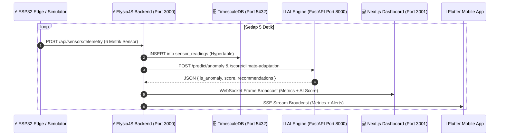
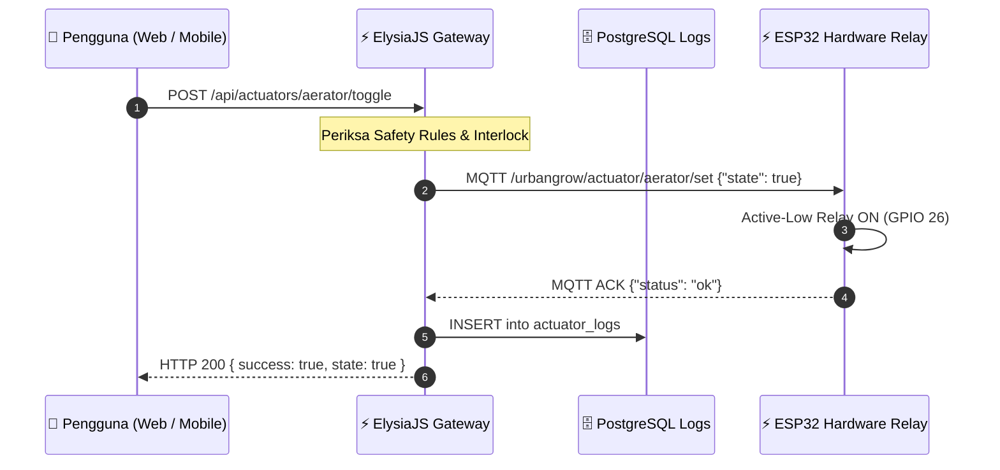

# 🏗️ UrbanGrow Architecture Deep Dive & Dataflow Blueprint

> **Dokumen Teknis**: Alur Data End-to-End Dari Akuisisi Sensor Fisik Hingga Tampilan Dashboard  
> **Institusi**: SMK Telkom Sidoarjo (Regu Mawar)  
> **Status**: Approved System Architecture

---

## 🔄 1. Sequence Diagram Alur Data Telemetri & Prediksi AI

---

## 🎛️ 2. Sequence Diagram Kendali Aktuator & Interlock Keamanan

