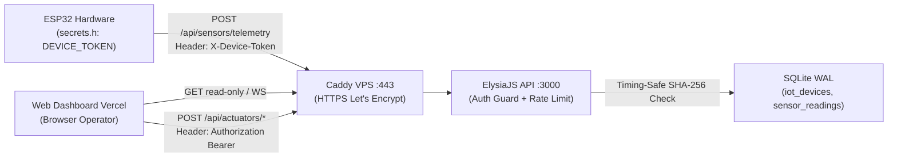

# 🔐 UrbanGrow IoT & Control Tokenization Plan (`TOKENIZE-IOT.md`)

> **Proyek**: UrbanGrow Smart Aquaponic (ESP32 + ElysiaJS/Bun VPS + Next.js Vercel)  
> **Lokasi Dokumen**: [`docs/TOKENIZE-IOT.md`](TOKENIZE-IOT.md)  
> **Status**: Planning / Siap Dikerjakan **Setelah** Hardware ESP32 Fisik Berhasil Live Tanpa Token  
> **Referensi Terkait**:
> - [`services/backend/src/index.ts`](../services/backend/src/index.ts)
> - [`services/backend/src/db/sqlite.ts`](../services/backend/src/db/sqlite.ts)
> - [`.agents/rules/security-agent.md`](../.agents/rules/security-agent.md)
> - [`docs/SECURITY_INCIDENT_RUNBOOK.md`](SECURITY_INCIDENT_RUNBOOK.md)
> - [`firmware/esp32_urbangrow/secrets.h.example`](../firmware/esp32_urbangrow/secrets.h.example)

---

## 🎯 1. Latar Belakang & Tujuan

Saat ini jalur komunikasi `ESP32 -> VPS (Caddy + ElysiaJS + SQLite) -> Web Vercel` sengaja dibuat terbuka agar integrasi awal perangkat keras ESP32 berjalan cepat tanpa hambatan autentikasi.

Namun, karena API VPS bersifat publik di `https://urbangrow-api.reycannavaro.dev`, kondisi tanpa token memiliki risiko berikut:
1. **Spoofing Data Sensor**: Pihak luar yang mengetahui endpoint `POST /api/sensors/telemetry` dapat mengirim JSON palsu (membuat status palsu atau memicu alert/rekomendasi AI yang salah).
2. **Unauthorized Actuator Control**: Siapa saja yang mengakses endpoint `POST /api/actuators/:id/toggle` atau `/api/feed/dispense` dapat menyalakan/mematikan pompa fisik kolam dan auto-feeder secara jarak jauh.
3. **Replay & Spam Relay**: Request berulang terlalu cepat berisiko merusak kontaktor relay mekanis (*contact arcing*).

Dokumen ini merancang penerapan **Token Autentikasi Terpisah (Device Token vs Operator Session)**, penguncian **CORS**, **Rate Limiting**, dan **Verifikasi Sertifikat TLS**, dengan transisi bertahap agar sistem produksi tetap online tanpa downtime (*zero-downtime cutover*).

---

## 🧭 2. Arsitektur Keamanan Target (Pemisahan 3 Zona Kepercayaan)



### Prinsip Wajib (Non-Negotiable Rules)
1. **Pisahkan Device Token & Website Token**:
   - **`X-Device-Token`** hanya boleh tertanam di `secrets.h` milik ESP32 (file `.gitignore`, tidak pernah masuk GitHub) dan divalidasi oleh VPS.
   - **Dilarang keras** menaruh `IOT_DEVICE_TOKEN` di `apps/web` atau variabel `NEXT_PUBLIC_*`, karena semua kode frontend dapat dilihat melalui Browser DevTools (`F12`).
2. **Jangan Simpan Plaintext Token di Database**:
   - Di VPS/SQLite hanya disimpan hash **`SHA-256(token)`** dan dibandingkan dengan `crypto.timingSafeEqual`.
3. **Kirim Token di HTTP Header, Bukan JSON Body**:
   - Gunakan header `X-Device-Token: <token>` atau `Authorization: Bearer <token>` (keduanya sudah diizinkan di `allowedHeaders` pada [`services/backend/src/index.ts`](../services/backend/src/index.ts#L215)).

---

## 📋 3. Roadmap Implementasi Bertahap

### Prasyarat (Milestone 0 — Sebelum Token Diaktifkan)
- [ ] Firmware ESP32 fisik sudah di-flash dan terbukti mengirim `POST /api/sensors/telemetry` ke `https://urbangrow-api.reycannavaro.dev`.
- [ ] Endpoint `/api/iot/status` sudah pernah menampilkan `edgeOnline: true` dari perangkat ESP32 fisik nyata.
- [ ] Kendali relay fisik `GPIO 14` dari `/controls` sudah berhasil teruji dua arah.

---

### Fase 1 — Device Token Authentication (`ESP32 <-> Backend VPS`)

**Target**: Hanya ESP32 terdaftar yang diizinkan mengirim telemetri sensor dan mengambil perintah kontrol.

1. **Skema Penyimpanan Token di SQLite (`services/backend/src/db/sqlite.ts`)**
   Tambahkan tabel `iot_devices`:
   ```sql
   CREATE TABLE IF NOT EXISTS iot_devices (
     device_id TEXT PRIMARY KEY,
     device_name TEXT NOT NULL,
     token_hash_sha256 TEXT NOT NULL,
     is_active INTEGER NOT NULL DEFAULT 1,
     last_seen_at TEXT,
     created_at TEXT NOT NULL DEFAULT CURRENT_TIMESTAMP,
     rotated_at TEXT
   );
   ```
   *Catatan fallback*: Untuk bootstrapping cepat via `.env` tanpa CLI DB, dukung juga env `IOT_DEVICE_TOKENS` (format JSON `{ "ESP32-GROW-01": "<sha256_or_raw>" }` atau single `IOT_DEVICE_TOKEN` untuk `ESP32-GROW-01`).

2. **Modul Validasi Baru (`services/backend/src/auth.ts`)**
   - Ekstrak token dari header `X-Device-Token` atau `Authorization: Bearer <token>`.
   - Hitung `SHA-256` token masuk dan cocokkan terhadap hash milik `device_id` (via `crypto.timingSafeEqual`).
   - Pastikan **`device_id` di payload JSON harus cocok dengan pemilik token** (mencegah perangkat A memalsukan data perangkat B).
   - Mode transisi `IOT_AUTH_MODE`:
     - `off`: Nonaktif (perilaku sekarang).
     - `log_only`: Mencatat peringatan di log `[IOT-AUTH]` jika token salah/kosong, tapi tetap mengizinkan masuk (`200 OK`) untuk verifikasi di lapangan.
     - `enforce`: Menolak request tanpa/salah token dengan **`HTTP 401 Unauthorized`** dan mismatch device dengan **`HTTP 403 Forbidden`**.

3. **Endpoint yang Diproteksi Device Token**:
   - `POST /api/sensors/telemetry` *(wajib token di mode `enforce`)*
   - `GET /api/iot/commands` *(wajib token saat menyertakan `device_id`, atau pindahkan ke header/query yang terautentikasi)*
   - *(Opsional)* `POST /api/simulation/sensor-override` (wajib token / internal test only).

4. **Update Firmware ESP32 (`firmware/esp32_urbangrow/`)**:
   - Tambah `#define URBANGROW_DEVICE_TOKEN "GANTI_DENGAN_TOKEN_PERANGKAT"` di `secrets.h.example` dan `README.md`.
   - Tambah di `esp32_urbangrow.ino`:
     ```cpp
     http.addHeader("X-Device-Token", URBANGROW_DEVICE_TOKEN);
     ```
   - Jika server mengembalikan `401` atau `403`, cetak pesan jelas ke Serial Monitor (`Token ditolak VPS, cek secrets.h`).

---

### Fase 2 — Network Hardening: CORS Lock, Rate Limit & Anti-Chatter Relay

**Target**: Melindungi VPS dan hardware fisik dari spam request maupun pemanggilan API dari domain asing.

1. **Penguncian CORS (`services/backend/src/index.ts`)**
   Ganti `origin: true` menjadi daftar allowlist berbasis env `CORS_ALLOWED_ORIGINS`:
   - Production default: `https://urbangrow.reycannavaro.dev` (plus opsional wildcard preview Vercel `*.vercel.app` jika dibutuhkan).
   - Development lokal: `http://localhost:3001`, `http://127.0.0.1:3001`.
   - *Catatan*: Perangkat ESP32 **tidak terkena aturan CORS** (CORS hanya berlaku untuk browser), sehingga mengunci CORS tidak akan memengaruhi koneksi ESP32.

2. **Rate Limiting & Relay Anti-Chatter (`services/backend/src/auth.ts` / middleware)**
   Mengacu pada [`.agents/rules/security-agent.md`](../.agents/rules/security-agent.md):
   - **Telemetri ESP32**: Batasi wajar misal maks 30 req/menit per `device_id` (`HTTP 429 Too Many Requests`).
   - **Kontrol Relay Web**: Cooldown minimal **3 detik** antar pergantian relay yang sama pada API kontrol agar kontaktor relay mekanis tidak mengalami keausan (*contact arching*).

3. ***(Opsional Lanjutan)* HMAC Payload Signing (`X-UrbanGrow-Signature`)**
   Sesuai standar pada `security-agent.md`, untuk level keamanan kompetisi/produksi tinggi, ESP32 dapat menandatangani body + timestamp memakai `mbedtls/md.h` (`HMAC-SHA256`) agar payload tidak bisa dimodifikasi di memori proxy perantara dan anti-replay.

---

### Fase 3 — Operator Access Control untuk Kontrol Website (`Web Vercel -> VPS`)

**Target**: Pengunjung umum tetap bisa melihat monitoring dashboard (*read-only* publik), tetapi hanya operator/tim terverifikasi yang bisa menekan tombol kontrol pompa, aerator, pakan, dan jadwal otomasi.

1. **Kebijakan Akses Publik vs Operator**:
   - **Publik (Tanpa Login)**: `GET /health`, `GET /api/sensors/current`, `GET /api/sensors/history`, `GET /api/alerts`, `GET /api/iot/status`, `GET /api/ai/*`, `WS /api/telemetry/ws`.
   - **Butuh Operator Token (`OPERATOR_ACCESS_MODE=enforce`)**:
     - `POST /api/actuators/:id/toggle`
     - `POST /api/actuators/:id/set`
     - `POST /api/feed/dispense`
     - `POST /api/schedules` / `PATCH /api/schedules/:id/toggle` / `DELETE /api/schedules/:id`
     - `POST /api/alerts/resolve-all`
     - `POST /api/ai/cohort`
     - `POST /api/simulation/anomaly`
2. **Mekanisme Login Ringan di Backend + Web (`POST /api/auth/login`)**:
   - Operator memasukkan PIN / passphrase tim (disimpan ter-hash di `.env` VPS sebagai `OPERATOR_PASSCODE_HASH`) -> VPS mengembalikan short-lived signed session token (HMAC/JWT masa berlaku 12 jam).
   - Di Web (`apps/web/lib/apiConfig.ts`), simpan session token hanya di `sessionStorage`, dan jika ada `401` saat user klik saklar di `/controls` atau `/`, tampilkan modal **"Buka Mode Operator (PIN)"** sebelum mengulang aksi.

---

### Fase 4 — ACK Konfirmasi Relay & Root CA Pinning (Produksi Penuh)

**Target**: Mengadopsi dua peningkatan keandalan dari catatan GDoc pembimbing.

1. **Command Delivery & Execution Tracking (`device_commands` / ACK)**
   - Menambahkan `command_seq` atau `command_id` di respons `POST /api/sensors/telemetry` dan endpoint `POST /api/iot/commands/:id/ack`.
   - Dashboard `/controls` dapat membedakan status: *"Perintah Dikirim ke Antrean"* vs *"Dieksekusi oleh ESP32 pada HH:MM WIB"*.
2. **Transisi TLS ESP32 dari `setInsecure()` ke `setCACert()`**
   - Mengganti `client.setInsecure()` pada [`esp32_urbangrow.ino`](../firmware/esp32_urbangrow/esp32_urbangrow.ino#L195) dengan sertifikat **ISRG Root X1** (Root CA resmi Let's Encrypt yang dipakai Caddy, valid hingga tahun **2035** sehingga aman walau sertifikat leaf domain diperbarui otomatis tiap 90 hari).
   - Menambahkan sinkronisasi waktu NTP (`configTime(0, 0, "pool.ntp.org", "time.google.com")`) sebelum validasi sertifikat TLS agar `ESP32` mengetahui waktu sertifikat valid.

---

## 🔄 4. Prosedur Cutover Tanpa Gangguan (Zero-Downtime Rollout)

Agar hardware di lapangan tidak tiba-tiba terputus saat token mulai diaktifkan:

1. **Generate Token Acak** di terminal:
   ```bash
   bun -e "console.log('ug_dev_' + crypto.randomUUID().replaceAll('-', '') + crypto.randomUUID().replaceAll('-', '').slice(0, 16))"
   ```
2. **Deploy Backend ke VPS dalam mode `IOT_AUTH_MODE=log_only`**:
   - Set `IOT_DEVICE_TOKEN` di VPS `/home/ubuntu/urbangrow-eng/services/backend/.env`.
   - Restart service `urbangrow-backend` — perangkat lama **masih bisa masuk** tanpa putus.
3. **Update & Flash Firmware ESP32**:
   - Masukkan token ke `firmware/esp32_urbangrow/secrets.h` (pastikan tidak ikut ter-commit ke Git).
   - Flash ke ESP32 dan pantau Serial Monitor (`HTTP 200 OK`) serta log VPS (`journalctl -u urbangrow-backend`) untuk memastikan header `X-Device-Token` terbaca `VALID`.
4. **Aktifkan Mode Ketat (`IOT_AUTH_MODE=enforce`)**:
   - Ubah `.env` VPS menjadi `IOT_AUTH_MODE=enforce`, lalu `sudo systemctl restart urbangrow-backend`.
   - Uji coba tembak tanpa token via PowerShell -> wajib ditolak **`401 Unauthorized`**.
   - Verifikasi ESP32 fisik tetap rutin memperbarui sensor **`live_iot`** dengan `200 OK`.

---

## ✅ 5. Rencana Pengujian & Verifikasi (Test Matrix)

| Skenario Uji | Metode | Ekspektasi Hasil |
|---|---|---|
| Kirim telemetri **tanpa** header token (`enforce`) | `bun test` + PowerShell `Invoke-RestMethod` | HTTP `401 Unauthorized`, state sensor di web tidak berubah |
| Kirim telemetri dengan token **salah** (`enforce`) | `bun test` + PowerShell | HTTP `401 Unauthorized` |
| Kirim telemetri dengan token milik device lain (`device_id` beda) | `bun test` | HTTP `403 Forbidden` |
| Kirim telemetri ESP32 dengan `X-Device-Token` **valid** | `bun test` + ESP32 fisik | HTTP `200 OK`, `sensorSources` menjadi `live_iot` & commands diterima |
| Request `/api/iot/commands` **tanpa** token (`enforce`) | `bun test` | HTTP `401 Unauthorized` |
| Request kontrol pompa dari origin **non-Vercel** saat CORS aktif | `curl -H "Origin: https://evil.example"` | Header `Access-Control-Allow-Origin` tidak diizinkan untuk origin asing |
| Klik toggle pompa **tanpa** operator session (`OPERATOR_ACCESS_MODE=enforce`) | `bun test` / Browser Incognito | HTTP `401`, Web memunculkan prompt PIN Operator |
| Rotasi token darurat (jika `secrets.h` tidak sengaja tersebar) | Update `IOT_DEVICE_TOKEN` / DB hash + flash ulang ESP32 | Token lama langsung ditolak `401`, ESP32 baru tetap `200 OK` |

---

## 📁 6. Daftar File yang Terlibat Saat Eksekusi Nanti

| Bagian | File | Perubahan |
|---|---|---|
| **Backend Auth** | `services/backend/src/auth.ts` *(baru)* | Validasi `X-Device-Token` / `Bearer` timing-safe SHA-256, rate limiter, & operator session HMAC |
| **Backend SQLite** | [`services/backend/src/db/sqlite.ts`](../services/backend/src/db/sqlite.ts) | Tabel `iot_devices` + helper lookup/rotasi token |
| **Backend Router** | [`services/backend/src/index.ts`](../services/backend/src/index.ts) | Middleware auth pada endpoint IoT & kontrol, penguncian CORS, endpoint `/api/auth/login` & opsional `/ack` |
| **Backend Tests** | [`services/backend/src/test/iotBridgeAndChat.test.ts`](../services/backend/src/test/iotBridgeAndChat.test.ts) | Penambahan test suite autentikasi `401`/`403`/`200` & anti-chatter |
| **Backend Env** | [`services/backend/.env.example`](../services/backend/.env.example) | Dokumentasi variabel `IOT_AUTH_MODE`, `IOT_DEVICE_TOKEN`, `CORS_ALLOWED_ORIGINS`, `OPERATOR_PASSCODE_HASH` |
| **Firmware ESP32** | [`firmware/esp32_urbangrow/secrets.h.example`](../firmware/esp32_urbangrow/secrets.h.example), [`esp32_urbangrow.ino`](../firmware/esp32_urbangrow/esp32_urbangrow.ino) | Pengiriman header `X-Device-Token` & dukungan opsional `ISRG Root X1` + NTP |
| **Web Dashboard** | [`apps/web/lib/apiConfig.ts`](../apps/web/lib/apiConfig.ts), [`apps/web/lib/telemetryContext.tsx`](../apps/web/lib/telemetryContext.tsx) | Pengiriman header session operator & modal unlock PIN bila kontrol dikunci |

